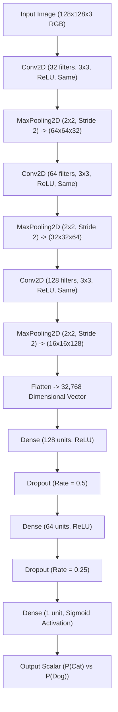

# 🧠 Neural Architecture & Deep Learning Specifications

This document provides a comprehensive technical breakdown of the neural architectures, mathematical formulations, and layer hierarchies implemented in **NeuralVision Studio (KerasLab)**.

---

## 🏗️ Model Architecture Overview

The studio supports three distinct neural architectures suited for different compute profiles and accuracy requirements:

1. **Custom Convolutional Neural Network (From Scratch)**
2. **VGG16 Feature Extractor (ImageNet Transfer Learning)**
3. **ResNet50 Deep Residual Network (Identity Skip Connections)**

---

## 1. Custom CNN Architecture Diagram



---

## 2. Layer-by-Layer Technical Specifications

### 🔹 Layer 1: Input Layer
- **Tensor Shape**: `(None, 128, 128, 3)`
- **Representation**: 3-channel RGB image normalized to float range `[0.0, 1.0]`.

### 🔹 Layer 2 & 3: Convolutional Block 1
- **`Conv2D(32, (3, 3), activation='relu', padding='same')`**:
  - Applies 32 learnable kernels of size $3 \times 3 \times 3$.
  - Output shape: `(None, 128, 128, 32)`.
  - Captures low-level spatial primitives (horizontal/vertical edges, color gradients).
- **`MaxPooling2D(pool_size=(2, 2))`**:
  - Takes maximum value over $2 \times 2$ sliding windows.
  - Output shape: `(None, 64, 64, 32)`.
  - Provides spatial translation invariance and halves spatial resolution.

### 🔹 Layer 4 & 5: Convolutional Block 2
- **`Conv2D(64, (3, 3), activation='relu', padding='same')`**:
  - Applies 64 filters across the 32 input feature maps.
  - Output shape: `(None, 64, 64, 64)`.
  - Captures intermediate spatial features (textures, curves, corners).
- **`MaxPooling2D(pool_size=(2, 2))`**:
  - Output shape: `(None, 32, 32, 64)`.

### 🔹 Layer 6 & 7: Convolutional Block 3
- **`Conv2D(128, (3, 3), activation='relu', padding='same')`**:
  - Applies 128 filters to encode high-level semantic representations (whiskers, ears, snouts).
  - Output shape: `(None, 32, 32, 128)`.
- **`MaxPooling2D(pool_size=(2, 2))`**:
  - Output shape: `(None, 16, 16, 128)`.

### 🔹 Layer 8: Flattening
- **`Flatten()`**:
  - Unrolls the 3D tensor $16 \times 16 \times 128$ into a 1D vector of length $32,768$.

### 🔹 Layer 9 & 10: Fully Connected Dense & Dropout
- **`Dense(128, activation='relu')`**:
  - Computes non-linear combination across all 32,768 extracted features.
- **`Dropout(0.5)`**:
  - Zeroes 50% of activation outputs during training to eliminate unit co-adaptation and prevent overfitting.

### 🔹 Layer 11 & 12: Secondary Dense & Dropout
- **`Dense(64, activation='relu')`**:
  - Compresses features into a compact decision space.
- **`Dropout(0.25)`**:
  - Lightweight secondary regularization.

### 🔹 Layer 13: Binary Output Layer
- **`Dense(1, activation='sigmoid')`**:
  - Applies the Sigmoid function:
    $$\sigma(z) = \frac{1}{1 + e^{-z}}$$
  - Outputs a probability value in $[0.0, 1.0]$.
  - $\hat{y} \ge 0.5 \implies$ **Cat (Class 1)**; $\hat{y} < 0.5 \implies$ **Dog (Class 0)**.

---

## 3. Transfer Learning Architectures

### 🔹 VGG16 (Visual Geometry Group - 16 Layers)
- **Concept**: Homogeneous architecture featuring 13 convolutional layers with $3 \times 3$ filters and 5 max pooling operations, pre-trained on ImageNet (1.4M images, 1000 categories).
- **Adaptation**:
  - Base convolutional backbone is frozen (`trainable = False`).
  - Spatial dimension is pooled using `GlobalAveragePooling2D()` (reduces $4 \times 4 \times 512 \rightarrow 512$).
  - Custom Dense classification head: `Dense(128) -> Dropout(p) -> Dense(1, Sigmoid)`.

### 🔹 ResNet50 (Residual Network - 50 Layers)
- **Concept**: Introduces identity shortcut connections to solve the degradation problem in deep neural networks:
  $$\mathcal{H}(x) = \mathcal{F}(x, \{W_i\}) + x$$
- **Advantages**:
  - Backpropagated gradients flow directly through the skip connections, eliminating vanishing gradient problems.
  - Generates rich semantic embeddings with superior generalization.

---

## 4. Loss Function & Optimization

### Binary Cross-Entropy Loss
The network optimizes binary cross-entropy:
$$\mathcal{L}(y, \hat{y}) = -\frac{1}{N} \sum_{i=1}^N \Big[ y_i \log(\hat{y}_i) + (1 - y_i) \log(1 - \hat{y}_i) \Big]$$

### Adam Optimizer (Adaptive Moment Estimation)
Combines momentum and RMSprop to maintain moving averages of past gradients and squared gradients:
$$m_t = \beta_1 m_{t-1} + (1 - \beta_1) g_t, \quad v_t = \beta_2 v_{t-1} + (1 - \beta_2) g_t^2$$
$$\theta_{t+1} = \theta_t - \frac{\alpha}{\sqrt{\hat{v}_t} + \epsilon} \hat{m}_t$$

---

## 5. Execution Guide
To launch the interactive training dashboard:
```bash
streamlit run app.py
```
